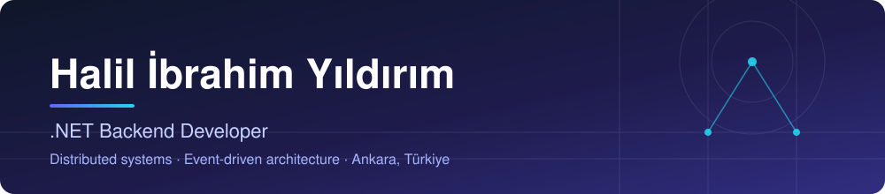

  

  Computer Engineering graduate (Tarsus University). 
  I build backend systems that stay correct under failure: event sourcing, messaging, idempotency and clear service boundaries.

  
  
  

 

## Focus

<table>
  <tr>
    <td width="33%" valign="top">
      <b>Event-driven systems</b>  
      Event sourcing, CQRS, outbox/inbox, sagas, at-least-once delivery with idempotent consumers.
    </td>
    <td width="33%" valign="top">
      <b>Secure by design</b>  
      JWT and role-based access, PII masking, audit trails, pseudonymization, tamper-evident data.
    </td>
    <td width="33%" valign="top">
      <b>Reliability and performance</b>  
      Gateways and load balancing, bounded retries, health checks, tracing, repeatable benchmarks.
    </td>
  </tr>
</table>

## Selected work

[**Blinkr**](https://github.com/devlightening/Blinkr) ·
[**Dytopia**](https://github.com/devlightening/MyDietitianMobileApp-Dytopia) ·
[**CloakAPI**](https://github.com/devlightening/CloakAPI) ·
[**RASP-LB**](https://github.com/devlightening/RASP-LB-Adaptive-LB) ·
[**SentimentGuard**](https://github.com/devlightening/SentimentGuard) ·
[**MicroCommerce**](https://github.com/devlightening/MicroCommerce)

Every repository above has its own README with architecture, run instructions and known limits.

## Microservice patterns

One small, focused repository per pattern.

| | |
|---|---|
| **Distributed transactions** | [Saga · Choreography](https://github.com/devlightening/Microservices-SagaPattern-Choreography) · [Saga · Orchestration](https://github.com/devlightening/Microservices-SagaPattern-Orchestration) · [2PC](https://github.com/devlightening/2PC-Distributed-Transaction-Manager) |
| **Messaging reliability** | [Outbox / Inbox](https://github.com/devlightening/Microservices-OutBox-InBox-DesignPattern) · [Synchronization](https://github.com/devlightening/Microservices-Synchronization-Patterns) · [Communication models](https://github.com/devlightening/Inter-ServiceCommunicationModels) |
| **CQRS and event sourcing** | [CQRS](https://github.com/devlightening/Microservices-CQRS-Pattern) · [Event Store](https://github.com/devlightening/Microservices-Event-Store) · [Read side](https://github.com/devlightening/Microservices-EventStore-ReadData) |
| **Gateways and traffic** | [YARP](https://github.com/devlightening/Microservices-APIGateway-YARP) · [Ocelot](https://github.com/devlightening/Microservices-APIGateway-Ocelot) · [NGINX](https://github.com/devlightening/Microservices-NGINX-Load-Balancing) |
| **Observability** | [Health checks](https://github.com/devlightening/Microservices-Health-Checks) · [Traceability](https://github.com/devlightening/Microservices-Traceability) |

## Tech

  
  
  
  
  
  
  
  
  
  
  
  
  
  
  
  
  

## Principles

- **Clarity over cleverness.** Readable code and explicit error handling first.
- **Correctness under failure.** At-least-once delivery plus idempotent consumers, not claims of exactly-once.
- **Measure before changing.** Repeated benchmark runs and honest limits.
- **Write it down.** Architecture overview, validation and known limits in every flagship README.

## Currently

OpenTelemetry observability, resilience engineering, automated tests and CI for my flagship projects.

 

Open to junior .NET backend roles · Ankara, Türkiye

